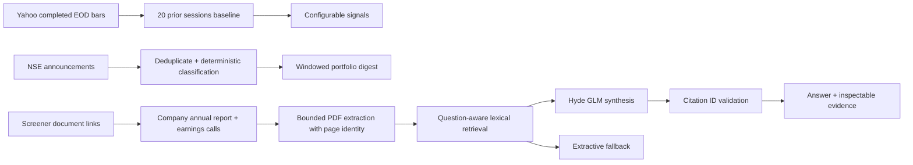

# Product and engineering decisions

## Product thesis

An investor needs an answer to “What deserves my attention?” before “What else can I read?” FINN’s first screen is a ranked queue, with administrative filings collapsed but inspectable. Original evidence is always one action away. A signal opens a filing; a company opens a research desk. The signature interaction is the promise ledger: a forecast becomes a dated commitment with a measurable outcome.

The visual system uses quiet surfaces, restrained copper accents, large evidence-led headlines and an always-available mobile navigation bar. The dense desktop view adapts into a readable phone flow. Dialogs use native modal focus management and Escape dismissal. Settings and bookmarks persist locally.

## Data flow

The client starts with a bundled snapshot. Refresh is explicit, then live mode checks every five minutes while the tab is visible. It is an in-app proactive feed, not a claim of operating a background push service. Stable signal IDs avoid duplicate event identities.

## Where intelligence lives

Cheap deterministic operations handle bulk ingestion, classification, comparison and threshold evaluation. They are auditable and require no model tokens. A model runs only after a user asks a research question. The retrieval path is independent of the verified cases.

Screener serves only as a link index. Generated Screener summaries, broker notes and news are excluded. The server fetches at most one annual report and two recent calls per question; stores bounded in-memory caches; preserves source/page identity; and selects up to eight distinct relevant pages. The same source cannot supply duplicate chunks from the same page. The model receives roughly 11,200 characters of retrieved evidence rather than an entire report.

Hyde is accessed with its documented OpenAI-compatible HTTP endpoint and `hyde/glm-5.3-flash`. The system prompt requires factual citations, matching financial periods and units, and explicit uncertainty. Source text is untrusted data. Citation IDs are checked against retrieved evidence before a generated answer is accepted. This prevents invented reference IDs; it does **not** establish entailment. Generated claims still need evidence review. If the model fails or the key is absent, original passages and coverage limitations remain available.

## Financial discipline

- Compare constant-currency full-year guidance to constant-currency full-year actuals. A four-quarter forecast history is not four quarterly forecasts.
- Infosys’s opening guidance excluded an acquisition later included in the figures. The ledger discloses this comparability limitation.
- Use consolidated IFRS data for the displayed quarter and cash reconciliation. Do not mix Ind AS CFO with IFRS FCF.
- Use PAT attributable to owners consistently in quarterly comparisons.
- Revenue, PBT, PAT and operating profit are extracted from verified tables. EBITDA remains blank when not reported in the selected tables.
- Price/volume signals describe movement, not its cause. Volume averages use the preceding 20 valid completed sessions, excluding the current bar. Raw price moves can be distorted by corporate actions.
- Report dates, call dates and publication dates are different. Verified case cutoffs are June/August 2025 and never masquerade as current research.

## Efficiency and failure behavior

| Work | Cache / bound | Failure behavior |
|---|---|---|
| EOD series | 15 minutes; 4 companies per batch | Price unavailable in coverage |
| NSE filings | 5 minutes; up to 150 per symbol | Missing exchange coverage is explicit |
| Link discovery | 1 hour | Explain unavailable ticker/documents |
| PDF pages | 24 hours, in-memory | Display failed source and original link |
| Model synthesis | User initiated; 2,800 output-token cap | Cited extracts remain available |
| Request limits | 12 requests / 10 minutes / IP / isolate | 429 response |

PDFs are capped at 12 MB and 600 pages. Images are not rendered. Pages are extracted sequentially; scanned PDFs require future OCR. Redirects are checked at every hop; URL inputs are not accepted from the client. Caches and rate limits are prototype-local to a Worker isolate and reset on restart. A production service needs durable storage, globally enforced quotas and authentication.

## What I would build next

1. Store immutable documents and extraction versions, document hashes, effective publication times and citation spans in durable storage.
2. Add an exchange scheduler, conditional fetches and a durable alert-delivery ledger; then opt-in push notifications.
3. Add structured statement extraction with accounting-basis validation, table coordinates, numerical reconciliation and human review for uncertain values.
4. Replace simple retrieval with measured hybrid retrieval; build an analyst-labeled test set for materiality, evidence entailment and abstention.
5. Follow commitments across later results and calls, explicitly distinguishing revised guidance from outcomes and acquisition-related changes.

## Stack trade-off

Vinext/React makes the mobile and desktop product one implementation and deploys to the supplied Cloudflare runtime. It is a beta framework, so the repository includes type checks, a build and actual browser journeys. Framework starter support files remain in the repository; application behavior is concentrated in the implementation map in the README. A production choice would also evaluate a stable framework/runtime against the same tests.
